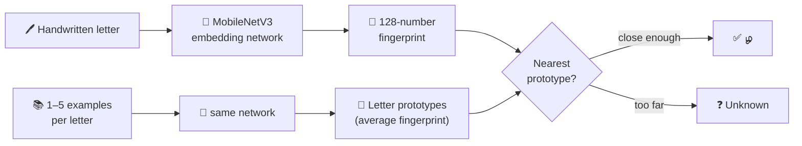
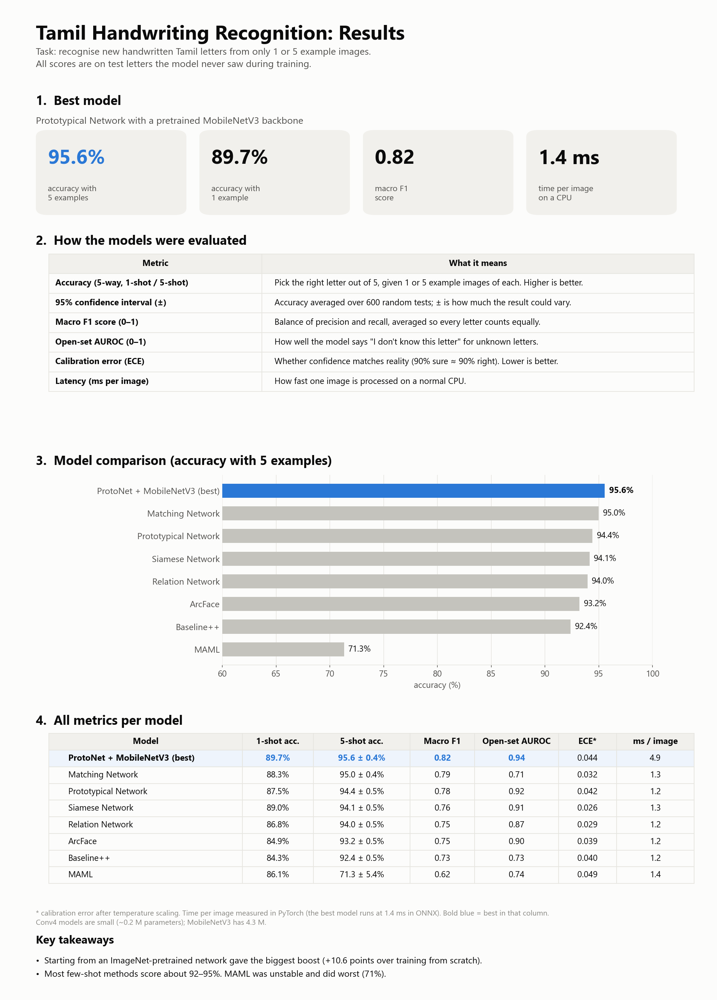
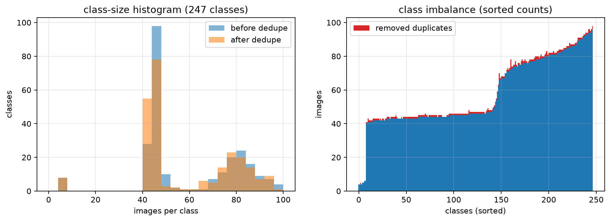
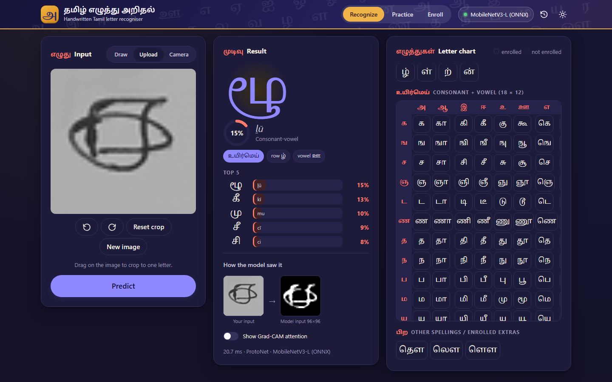
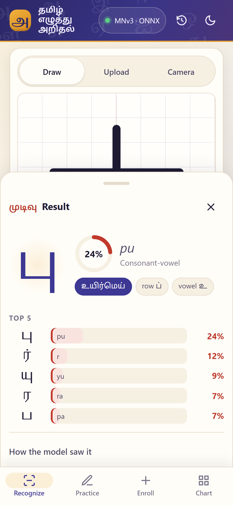
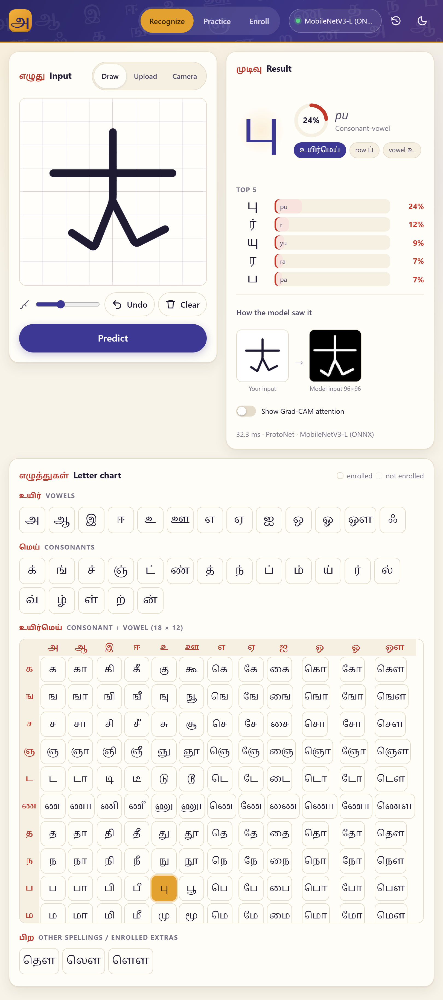
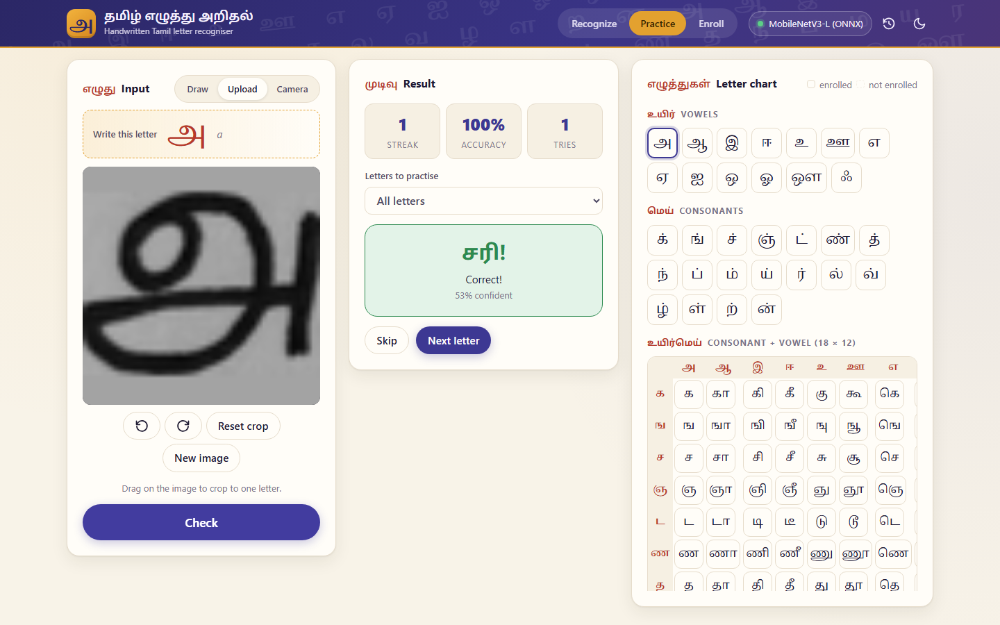
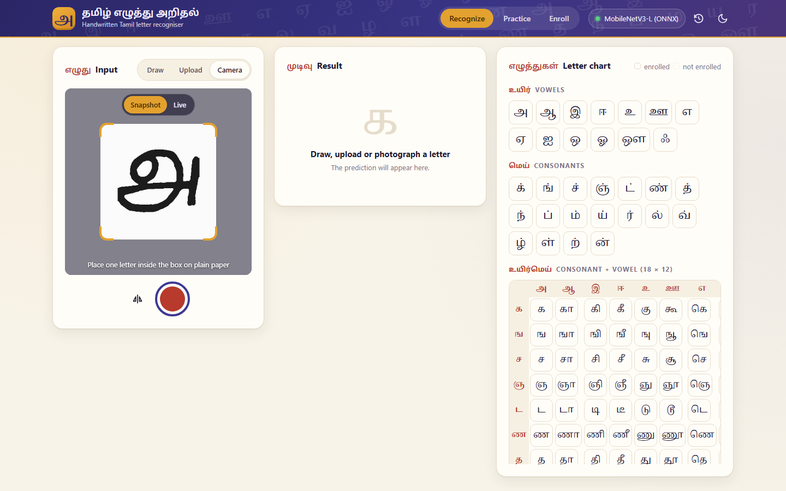
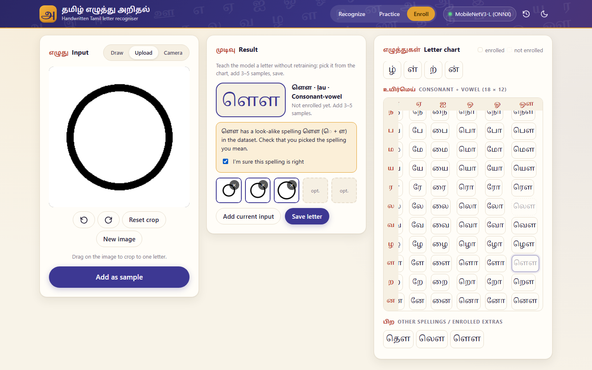
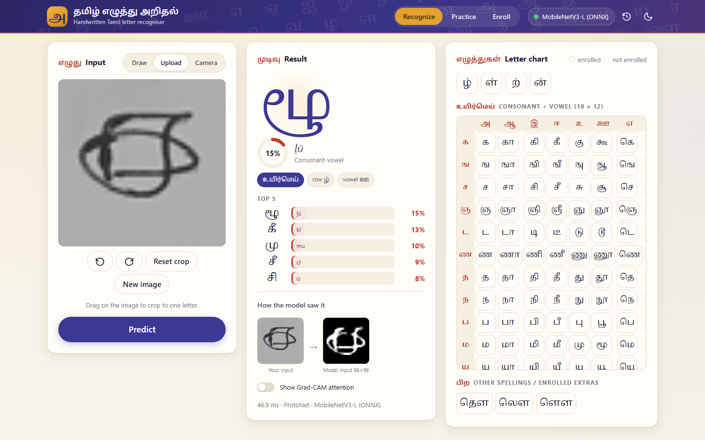

<div align="center">

# ✍️ தமிழ் எழுத்து அறிதல்
### Few-Shot Handwritten Tamil Character Recognition

**Recognise handwritten Tamil letters from just 1–5 examples, including letters the model has never seen.**


[📊 Results](#-results) • [🗂️ Dataset](#%EF%B8%8F-the-dataset) • [🚀 Quick start](#-quick-start) • [🖥️ Web app](#%EF%B8%8F-try-it-in-the-browser) • [📚 Reports](#-reports)

</div>

---

> [!IMPORTANT]
> ## 🎓 Dataset collected by PEP DSA Students
> ### St. Joseph's College of Engineering, Chennai
>
> Every one of the **14,463 handwritten letter images** in [`tamil_handwritten_Dataset/`](tamil_handwritten_Dataset/) was
> written, scanned and labelled by the **PEP DSA students of St. Joseph's College of Engineering, Chennai**.
> This project would not exist without their work. 🙏

---

## 💡 What it does

Ordinary classifiers need hundreds of images per letter and must be retrained to learn a new one. This project uses **few-shot metric learning** instead:



- 🆕 **Add a new letter without retraining.** Give it 3–5 samples and it is recognised immediately.
- 🚫 **Knows when it doesn't know.** Letters it was never shown are rejected as *unknown*.
- ⚡ **Runs fast on a CPU.** It is exported to ONNX, needs no GPU, and takes about 1.4 ms per image.

---

## 📊 Results



### 🏆 Best model: Prototypical Network + ImageNet-pretrained MobileNetV3-Large (96 px, ONNX)

| Metric (letters **never seen** in training) | Score |
|---|:---:|
| 🎯 Accuracy, 5-way 5-shot | **95.6% ± 0.4** |
| 🎯 Accuracy, 5-way 1-shot | 89.7% |
| 🔤 Accuracy, all 37 unseen letters, 5-shot | 83.5% |
| ⚖️ Macro F1 | 0.82 |
| 🚫 Open-set AUROC (rejecting unknown letters) | 0.94 |
| ⚡ CPU time per image (ONNX Runtime) | 1.4 ms |

<details>
<summary><b>🥊 Compare all 8 models (click to expand)</b></summary>

| Model | 1-shot | 5-shot | Macro F1 | Open-set AUROC |
|---|:---:|:---:|:---:|:---:|
| 🥇 **ProtoNet + MobileNetV3 (pretrained)** | **89.7%** | **95.6%** | **0.82** | **0.94** |
| 🥈 Matching Network | 88.3% | 95.0% | 0.79 | 0.71 |
| 🥉 Prototypical Network | 87.5% | 94.4% | 0.78 | 0.92 |
| Siamese Network (triplet) | 89.0% | 94.1% | 0.76 | 0.91 |
| Relation Network | 86.8% | 94.0% | 0.75 | 0.87 |
| ArcFace | 84.9% | 93.2% | 0.75 | 0.90 |
| Baseline++ | 84.3% | 92.4% | 0.73 | 0.73 |
| MAML (first-order) | 86.1% | 71.3% | 0.62 | 0.74 |

Unless named otherwise, models use a small Conv4 backbone (~0.2 M parameters). Every score is on the test set, averaged over at least 600 random episodes.

</details>

<details>
<summary><b>📏 What do these metrics mean?</b></summary>

- **N-way K-shot accuracy:** pick the correct letter out of N, given K example images of each.
- **± (95% confidence interval):** how much the accuracy could vary across test episodes.
- **Macro F1:** precision and recall, averaged so that every letter counts equally.
- **Open-set AUROC:** how well the model says "I don't know" for letters it wasn't given.
- **ECE (calibration error):** whether the model's confidence matches how often it is right.
- **Latency:** time to process one image on a CPU.

</details>

---

## 🗂️ The dataset

<div align="center">

| 🔤 Letter classes | 🖼️ Images | 📐 Size | ✍️ Collected by |
|:---:|:---:|:---:|:---:|
| **247** | **14,463** | 48 × 48 PNG | **PEP DSA Students, SJCE Chennai** |

</div>

```
tamil_handwritten_Dataset/
├── உயிர் எழுத்துக்கள்/        vowels (அ ஆ இ ஈ …)
├── உயிர்மெய் எழுத்துக்கள்/    consonant + vowel combinations (க கா கி …)
├── ஆய்தம்/                    the āytam (ஃ)
└── metadata.csv, class_counts.csv, duplicates.csv, …   audit files
```

Each folder holds one letter, and the folder name is the label. Two evaluation protocols are used:

- 📘 **Protocol A:** letters seen in training (new writers only).
- 📕 **Protocol B:** **37 letters held out completely**, to test whether the model can recognise letters it has never seen.

<details>
<summary><b>🔍 Dataset audit and figures</b></summary>



The full audit is in [`reports/audit.md`](tamil-dl-fewshot-htr/reports/audit.md). It covers corrupt files, duplicates, label conflicts and per-class counts.

</details>

---

## 🖥️ Try it in the browser

A web app for **drawing**, **uploading** or **photographing** a letter. It works offline on a laptop, tablet or phone.

| Mode | What it does |
|---|---|
| 🔎 **Recognize** | Shows the top-5 letters with confidence and a Grad-CAM view of where the model looked |
| ✏️ **Practice** | Shows a letter to write, then answers "சரி!" or "மீண்டும் முயற்சி" |
| ➕ **Enroll** | Teaches the app a new letter from 3–5 samples, without retraining |



<details>
<summary><b>📱 More screenshots: phone, tablet, camera, practice</b></summary>

| Phone | Tablet | Practice |
|:---:|:---:|:---:|
|  |  |  |

| Camera | Enroll | Light theme |
|:---:|:---:|:---:|
|  |  |  |

</details>

---

## 🚀 Quick start

```bash
git clone https://github.com/thameemhub/Tamil_Character_Recognition_DSA_Contribution.git
cd Tamil_Character_Recognition_DSA_Contribution/tamil-dl-fewshot-htr
python -m venv .venv
.venv\Scripts\activate            # Windows   (Linux/macOS: source .venv/bin/activate)
pip install -r requirements.txt
```

Then choose how to try it:

```bash
python ui/run.py                           # 🖥️  web app at http://127.0.0.1:8000
python ui/run.py --lan                     # 📱  test on your phone over Wi-Fi (HTTPS, real camera)
python src/predict.py some_letter.png      # ⌨️  top-5 letters + confidence in the terminal
python src/app_canvas.py                   # 🖱️  draw a letter with the mouse
```

<details>
<summary><b>🐳 Run with Docker</b></summary>

```bash
cd tamil-dl-fewshot-htr
docker build -t tamil-htr .
docker run -p 7860:7860 tamil-htr        # then open http://localhost:7860
```

</details>

<details>
<summary><b>🔁 Retrain from scratch</b></summary>

```bash
python src/prepare_data.py                                   # rebuild the preprocessed arrays
python src/train_fewshot.py --set method.name=protonet       # train a model
```

See [`tamil-dl-fewshot-htr/README.md`](tamil-dl-fewshot-htr/README.md) for the full pipeline: audit, every method, evaluation and ONNX export.

</details>

---

## 🧭 Repository layout

```
📁 tamil_handwritten_Dataset/    ✍️ the dataset (category / letter / images)
📁 tamil-dl-fewshot-htr/
├── 📁 src/                      data prep, training, evaluation, export, demo apps
├── 📁 ui/                       FastAPI web app (draw · upload · camera)
├── 📁 tests/                    pytest suite (+ Playwright UI tests)
├── 📁 models/                   embedder.onnx (deployed model), embedder.pt, deploy.json
├── 📁 reports/                  PDF/HTML reports, comparison tables, figures, screenshots
├── 📁 data/support_set/         enrolled example images used for prediction
├── 🐳 Dockerfile
└── ⚙️ config.yaml               all settings
```

---

## 📚 Reports

| | |
|---|---|
| 📕 [Full report (PDF)](tamil-dl-fewshot-htr/reports/Tamil_FewShot_HTR_Report.pdf) | The complete write-up |
| 📝 [Summary](tamil-dl-fewshot-htr/reports/summary.md) | Key findings on one page |
| 🥊 [Model comparison](tamil-dl-fewshot-htr/reports/model_comparison.md) | Every method side by side |
| 🧠 [Design decisions](tamil-dl-fewshot-htr/reports/decisions.md) | Every choice and why it was made |
| 📈 [Detailed results figure](tamil-dl-fewshot-htr/reports/figures/results_summary.png) | All metrics in one chart |

---

## ⚠️ Limitations

- ⏱️ Most models trained for only 8–15 epochs. Accuracy was still improving, and about 44 epochs is recommended.
- 📉 8 letters have fewer than 15 images.
- 🌀 The two-part vowel-sign letters (ொ ோ ௌ) are the hardest to recognise.
- ✏️ Canvas strokes and phone photos look different from the scanned training images, so expect lower confidence in the web app.

---

<div align="center">

### 🙌 Acknowledgements

**Dataset collected by the PEP DSA Students of St. Joseph's College of Engineering, Chennai** 🎓

*If you use this dataset or code, please credit them.*

⭐ **Star the repo if you found it useful!** ⭐

</div>
