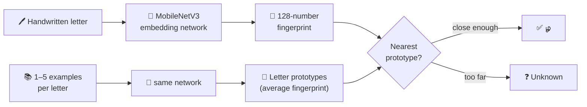

<div align="center">

# ✍️ தமிழ் எழுத்து அறிதல்
### Few-Shot Handwritten Tamil Character Recognition

**Recognise handwritten Tamil letters from just 1–5 examples, including letters the model has never seen.**


[🎓 Contributors](#-dataset-contributors) • [📊 Results](#-results) • [🗂️ Dataset](#%EF%B8%8F-the-dataset) • [🚀 Quick start](#-quick-start) • [📚 Reports](#-reports)

</div>

---

> [!IMPORTANT]
> ## 🎓 Dataset collected by PEP DSA Students
> ### St. Joseph's College of Engineering & St. Joseph's Institute of Technology, Chennai
>
> Every handwritten letter image in [`tamil_handwritten_Dataset/`](tamil_handwritten_Dataset/) was
> written, scanned and labelled by the **PEP DSA students of St. Joseph's College of Engineering & St. Joseph's Institute of Technology, Chennai**.
> This project would not exist without their work. 🙏
>
> 👉 [Meet the contributors](#-dataset-contributors)

---

## 🎓 Dataset contributors

The **PEP DSA students** who wrote, scanned and labelled the handwritten letters:

<p align="center">
<a href="https://github.com/lakshminarayanansurya" title="Lakshminarayanan R"></a>
<a href="https://github.com/Ashiq8" title="Syed Ashique Y"></a>
<a href="https://github.com/sanjana658" title="T. Sanjana"></a>
<a href="https://github.com/THEERAJ2006" title="Theeraj J"></a>
<a href="https://github.com/RoshiniSelwyn" title="Roshini S T S"></a>
<a href="https://github.com/LINGESH-0511" title="Lingesh N"></a>
<a href="https://github.com/darshu-AI" title="Priyadarshini R"></a>
<a href="https://github.com/hiboobesh-collab" title="Boobesh B"></a>
<a href="https://github.com/Dhanuraj-22" title="Dhanushree R"></a>
<a href="https://github.com/vidhyaveeranellu" title="Vidhya V"></a>
<a href="https://github.com/roshk10" title="Roshan Raguraman"></a>
<a href="https://github.com/pavithrakrishnan0705-code" title="Pavithra N K"></a>
<a href="https://github.com/Jeevan-git-06" title="Jeevan S A"></a>
<a href="https://github.com/Akashgks" title="Akash G K S"></a>
<a href="https://github.com/Poojabala30" title="Pooja B"></a>
<a href="https://github.com/gowtham007777" title="Gowtham S"></a>
<a href="https://github.com/dhanushkumar46" title="Dhanush Kumar T"></a>
<a href="https://github.com/Sibirichard06" title="Sibi Richard. J"></a>
<a href="https://github.com/VijayReddy-07" title="Vijay Reddy S"></a>
<a href="https://github.com/jayasurya18pappa" title="Jayasurya PV"></a>
<a href="https://github.com/Sherinovia19" title="Sherin Ovia"></a>
<a href="https://github.com/Sangamithradillibabu" title="Sangamithra Dillibabu"></a>
<a href="https://github.com/jeevashakthi06-cmd" title="Jeeva Shakthi L"></a>
<a href="https://github.com/rrtka" title="R Ritika"></a>
<a href="https://github.com/levinesh05r-sys" title="Levinesh R"></a>
<a href="https://github.com/raghuls48" title="Raghul S"></a>
<a href="https://github.com/Jaishnavi22" title="Jaishnavi P"></a>
<a href="https://github.com/kaviraj-debug" title="Kaviraj R"></a>
<a href="https://github.com/sadhanak195" title="Sadhana K"></a>
<a href="https://github.com/hareesh26122007-afk" title="Hareesh Kumar. S"></a>
<a href="https://github.com/samrohit2008-sys" title="Sam Rohit I"></a>
<a href="https://github.com/felshiamary21-png" title="Felshia Mary E"></a>
<a href="https://github.com/poojakamatchi2008-bot" title="Pooja P"></a>
<a href="https://github.com/chitteshkumars2007-spec" title="Chittesh Kumar S"></a>
<a href="https://github.com/srivathsan993-collab" title="Srivathsan N"></a>
<a href="https://github.com/abhi07pandian-dot" title="Abhinaya T"></a>
<a href="https://github.com/dbhoopesh1-tech" title="D Bhoopesh Sakthi Sudhan"></a>
<a href="https://github.com/krisnapriyaa" title="Krisnapriyaa"></a>
<a href="https://github.com/dharani1642008" title="Dharani R"></a>
<a href="https://github.com/Marojulahari07" title="Maroju Lahari"></a>
<a href="https://github.com/Jeffina-5127-C" title="Jeffina Hepzibah C"></a>
<a href="https://github.com/Jerfiya" title="Jerfiya J R"></a>
<a href="https://github.com/srinath212007-dev" title="Srinath S"></a>
<a href="https://github.com/rithizzoffl" title="Rithishsudarsan A S"></a>
<a href="https://github.com/SebaVarshini" title="Seba Varshini M"></a>
<a href="https://github.com/Jeevitha-210721" title="Jeevitha S"></a>
<a href="https://github.com/sahaana-offl" title="K. Sahaana"></a>
<a href="https://github.com/DevinInfant19-tech" title="Devin Infant M A"></a>
<a href="https://github.com/anusha1920a-crypto" title="Anusha K"></a>
<a href="https://github.com/theophlinaroslynd-dot" title="Theophlina Roslynd T"></a>
<a href="https://github.com/patg007" title="Patricia Mary G"></a>
<a href="https://github.com/vaishali01102007-bot" title="Vaishali G"></a>
<a href="https://github.com/fernandosandra82093-wq" title="Sandra. B"></a>
<a href="https://github.com/kess2702" title="Kesin S"></a>
<a href="https://github.com/stanso-spec" title="Stanso S"></a>
</p>

<details>
<summary><b>📜 See all names</b></summary>

Lakshminarayanan R · Syed Ashique Y · T. Sanjana · Theeraj J · Roshini S T S · Lingesh N · Priyadarshini R · Boobesh B · Dhanushree R · Vidhya V · Roshan Raguraman · Pavithra N K · Jeevan S A · Akash G K S · Pooja B · Gowtham S · Dhanush Kumar T · Sibi Richard. J · Vijay Reddy S · Jayasurya PV · Sherin Ovia · Sangamithra Dillibabu · Jeeva Shakthi L · R Ritika · Levinesh R · Hanash Wanis A F · Raghul S · Jaishnavi P · Kaviraj R · Sadhana K · Hareesh Kumar. S · Sam Rohit I · Felshia Mary E · Pooja P · Chittesh Kumar S · Srivathsan N · Abhinaya T · Vishal S · D Bhoopesh Sakthi Sudhan · Krisnapriyaa · Dharani R · Maroju Lahari · Jeffina Hepzibah C · Jerfiya J R · Srinath S · Rithishsudarsan A S · Seba Varshini M · Jeevitha S · K. Sahaana · Devin Infant M A · Anusha K · Theophlina Roslynd T · Patricia Mary G · Vaishali G · Sandra. B · Kesin S · Stanso S

</details>

👉 **Full list with department, college and year: [CONTRIBUTORS.md](CONTRIBUTORS.md)**


---

## 💡 What it does

Ordinary classifiers need hundreds of images per letter and must be retrained to learn a new one. This project uses **few-shot metric learning** instead:



- 🆕 **Add a new letter without retraining.** Give it 3–5 samples and it is recognised immediately.
- 🚫 **Knows when it doesn't know.** Letters it was never shown are rejected as *unknown*.
- ⚡ **Runs fast on a CPU.** It is exported to ONNX, needs no GPU, and takes about 1.4 ms per image.

---

## 📊 Results


### 🏆 Best model: Prototypical Network + ImageNet-pretrained MobileNetV3-Large (96 px, ONNX)

| Metric (letters **never seen** in training) | Score |
|---|:---:|
| 🎯 Accuracy, 5-way 5-shot | **95.6% ± 0.4** |
| 🎯 Accuracy, 5-way 1-shot | 89.7% |
| 🔤 Accuracy, all 37 unseen letters, 5-shot | 83.5% |
| ⚖️ Macro F1 | 0.82 |
| 🚫 Open-set AUROC (rejecting unknown letters) | 0.94 |
| ⚡ CPU time per image (ONNX Runtime) | 1.4 ms |

<details>
<summary><b>🥊 Compare all 8 models (click to expand)</b></summary>

| Model | 1-shot | 5-shot | Macro F1 | Open-set AUROC |
|---|:---:|:---:|:---:|:---:|
| 🥇 **ProtoNet + MobileNetV3 (pretrained)** | **89.7%** | **95.6%** | **0.82** | **0.94** |
| 🥈 Matching Network | 88.3% | 95.0% | 0.79 | 0.71 |
| 🥉 Prototypical Network | 87.5% | 94.4% | 0.78 | 0.92 |
| Siamese Network (triplet) | 89.0% | 94.1% | 0.76 | 0.91 |
| Relation Network | 86.8% | 94.0% | 0.75 | 0.87 |
| ArcFace | 84.9% | 93.2% | 0.75 | 0.90 |
| Baseline++ | 84.3% | 92.4% | 0.73 | 0.73 |
| MAML (first-order) | 86.1% | 71.3% | 0.62 | 0.74 |

Unless named otherwise, models use a small Conv4 backbone (~0.2 M parameters). Every score is on the test set, averaged over at least 600 random episodes.

</details>

<details>
<summary><b>📏 What do these metrics mean?</b></summary>

- **N-way K-shot accuracy:** pick the correct letter out of N, given K example images of each.
- **± (95% confidence interval):** how much the accuracy could vary across test episodes.
- **Macro F1:** precision and recall, averaged so that every letter counts equally.
- **Open-set AUROC:** how well the model says "I don't know" for letters it wasn't given.
- **ECE (calibration error):** whether the model's confidence matches how often it is right.
- **Latency:** time to process one image on a CPU.

</details>

---

## 🗂️ The dataset

<div align="center">

| 📐 Image size | ✍️ Collected by |
|:---:|:---:|
| 48 × 48 PNG | **PEP DSA Students, SJCE & SJIT Chennai** |

</div>

```
tamil_handwritten_Dataset/
├── உயிர் எழுத்துக்கள்/        vowels (அ ஆ இ ஈ …)
├── உயிர்மெய் எழுத்துக்கள்/    consonant + vowel combinations (க கா கி …)
├── ஆய்தம்/                    the āytam (ஃ)
└── metadata.csv, class_counts.csv, duplicates.csv, …   audit files
```

Each folder holds one letter, and the folder name is the label. Two evaluation protocols are used:

- 📘 **Protocol A:** letters seen in training (new writers only).
- 📕 **Protocol B:** **37 letters held out completely**, to test whether the model can recognise letters it has never seen.

<details>
<summary><b>🔍 Dataset audit</b></summary>

The full audit is in [`reports/audit.md`](tamil-dl-fewshot-htr/reports/audit.md). It covers corrupt files, duplicates and label conflicts.

</details>

---


## 🚀 Quick start

```bash
git clone https://github.com/thameemhub/Tamil_Character_Recognition_DSA_Contribution.git
cd Tamil_Character_Recognition_DSA_Contribution/tamil-dl-fewshot-htr
python -m venv .venv
.venv\Scripts\activate            # Windows   (Linux/macOS: source .venv/bin/activate)
pip install -r requirements.txt
```

Then choose how to try it:

```bash
python src/predict.py some_letter.png      # ⌨️  top-5 letters + confidence in the terminal
python src/app_canvas.py                   # 🖱️  draw a letter with the mouse
```

<details>
<summary><b>🔁 Retrain from scratch</b></summary>

```bash
python src/prepare_data.py                                   # rebuild the preprocessed arrays
python src/train_fewshot.py --set method.name=protonet       # train a model
```

See [`tamil-dl-fewshot-htr/README.md`](tamil-dl-fewshot-htr/README.md) for the full pipeline: audit, every method, evaluation and ONNX export.

</details>

---

## 🧭 Repository layout

```
📁 tamil_handwritten_Dataset/    ✍️ the dataset (category / letter / images)
📁 tamil-dl-fewshot-htr/
├── 📁 src/                      data prep, training, evaluation, export, demo apps
├── 📁 tests/                    pytest suite
├── 📁 models/                   embedder.onnx (deployed model), embedder.pt, deploy.json
├── 📁 reports/                  PDF/HTML reports, comparison tables, figures
├── 📁 data/support_set/         enrolled example images used for prediction
└── ⚙️ config.yaml               all settings
```

---

## 📚 Reports

| | |
|---|---|
| 📕 [Full report (PDF)](tamil-dl-fewshot-htr/reports/Tamil_FewShot_HTR_Report.pdf) | The complete write-up |
| 📝 [Summary](tamil-dl-fewshot-htr/reports/summary.md) | Key findings on one page |
| 🥊 [Model comparison](tamil-dl-fewshot-htr/reports/model_comparison.md) | Every method side by side |
| 🧠 [Design decisions](tamil-dl-fewshot-htr/reports/decisions.md) | Every choice and why it was made |
| 📈 [Detailed results figure](tamil-dl-fewshot-htr/reports/figures/results_summary.png) | All metrics in one chart |

---

## ⚠️ Limitations

- ⏱️ Most models trained for only 8–15 epochs. Accuracy was still improving, and about 44 epochs is recommended.
- 🌀 The two-part vowel-sign letters (ொ ோ ௌ) are the hardest to recognise.

---

<div align="center">

### 🙌 Acknowledgements

**Dataset collected by the PEP DSA Students of St. Joseph's College of Engineering & St. Joseph's Institute of Technology, Chennai** 🎓

*If you use this dataset or code, please credit them.*

⭐ **Star the repo if you found it useful!** ⭐

</div>
