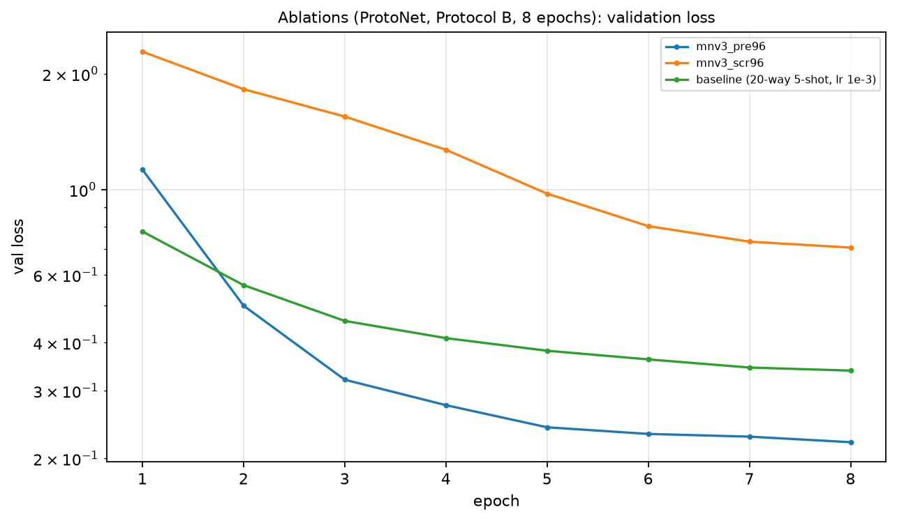
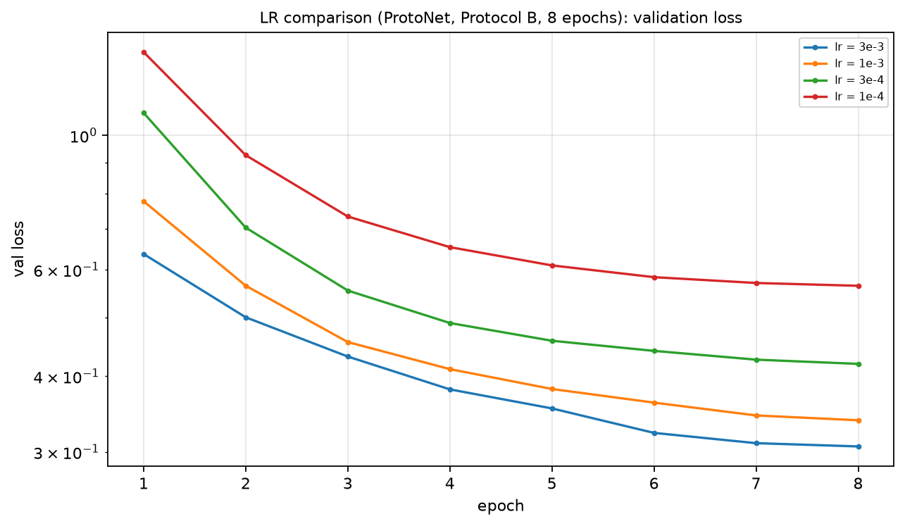

# Ablations (ProtoNet, Protocol B, validation only)

Each row is one 8-epoch run (50 episodes/epoch, cosine schedule over 8 epochs) that changes one thing from the baseline. Scores are the best epoch on the FIXED validation episodes (100 × 10-way 5-shot over the 37 val classes, never trained on). Test data was not used. Differences smaller than ~1.5 pp are inside the 95% CI and are treated as ties.

## Learning rate (judged by val-loss curves; see figures/lr_comparison.png)

| setting | best val loss (epoch) | Δ loss vs baseline | best val acc % (±CI) | Δ acc (pp) | params | s/epoch |
|---|---|---|---|---|---|---|
| lr 3e-3 | 0.3063 (8/8) | -0.0320 | 90.80 ± 0.87 | +1.34 | 186k | 178 |
| baseline: 20-way 5-shot, lr 1e-3, emb 128, Euclidean, EMA, 48 px, Conv4 | 0.3383 (8/8) | +0.0000 | 89.46 ± 0.98 | +0.00 | 186k | 138 |
| lr 3e-4 | 0.4193 (8/8) | +0.0809 | 86.52 ± 1.30 | -2.94 | 186k | 142 |
| lr 1e-4 | 0.5642 (8/8) | +0.2259 | 80.68 ± 1.44 | -8.78 | 186k | 127 |

## Backbone / pretraining

| setting | best val loss (epoch) | Δ loss vs baseline | best val acc % (±CI) | Δ acc (pp) | params | s/epoch |
|---|---|---|---|---|---|---|
| MobileNetV3-L ImageNet-pretrained, 96 px | 0.2204 (8/8) | -0.1179 | 93.98 ± 0.76 | +4.52 | 4325k | 480 |
| baseline: 20-way 5-shot, lr 1e-3, emb 128, Euclidean, EMA, 48 px, Conv4 | 0.3383 (8/8) | +0.0000 | 89.46 ± 0.98 | +0.00 | 186k | 138 |
| MobileNetV3-L from scratch, 96 px | 0.7066 (8/8) | +0.3683 | 75.22 ± 1.52 | -14.24 | 4325k | 463 |

## Not run

Dropped for CPU time and memory (see decisions.md, session 3); `run_batch3.sh` still lists them:

- train 5-way
- train 10-way
- train 30-way
- train 1-shot
- train mixed shots {1,2,3,5}
- embedding dim 64
- embedding dim 256
- cosine distance
- EMA off
- input 64 px (upsampled)
- ResNet-12 (width 16), scratch
- ResNet-18 (width 16), scratch
- EfficientNet-B0 ImageNet-pretrained, 96 px

## ArcFace pretraining vs episodic training from scratch (15-epoch final runs, Protocol B val)

| recipe | best val loss | best val acc % | epochs |
|---|---|---|---|
| ProtoNet from scratch | 0.2776 | 91.94 ± 0.85 | 15 |
| ArcFace head only (cosine protos) | 0.4355 | 90.22 ± 0.96 | 15 |
| ArcFace pretrain -> ProtoNet fine-tune | 0.2605 | 92.68 ± 0.70 | 15 |

Note: the ArcFace val loss is its cosine-prototype episode CE (scale s = 24) and is not on the same scale as ProtoNet's. Compare accuracy across recipes.

