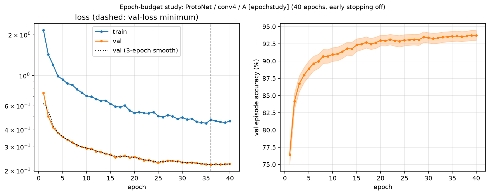

# Epoch-budget study (ProtoNet, Conv4, Protocol A, validation only)

Run: `20261116_222957_protonet_conv4_A_epochstudy`: 40 epochs × 50 episodes, cosine schedule over the whole budget, **early stopping off**. Validation is a fixed list of 100 10-way 5-shot episodes (no augmentation), so the val curve is comparable epoch to epoch.

| epoch | train loss | val loss | val acc % (±95% CI) | lr | overfit flag |
|---|---|---|---|---|---|
| 5 | 0.9354 | 0.3537 | 88.88 ± 1.14 | 9.85e-04 | 0 |
| 10 | 0.7080 | 0.2906 | 90.96 ± 0.99 | 8.96e-04 | 0 |
| 15 | 0.6212 | 0.2629 | 92.32 ± 0.91 | 7.41e-04 | 0 |
| 20 | 0.5312 | 0.2529 | 92.98 ± 0.78 | 5.46e-04 | 0 |
| 25 | 0.5048 | 0.2284 | 93.02 ± 0.82 | 3.44e-04 | 0 |
| 30 | 0.4920 | 0.2298 | 93.38 ± 0.75 | 1.70e-04 | 0 |
| 35 | 0.4460 | 0.2228 | 93.58 ± 0.73 | 5.17e-05 | 0 |
| 36 | 0.4738 | 0.2215 | 93.62 ± 0.74 | 3.68e-05 | 0 |
| 40 | 0.4618 | 0.2241 | 93.72 ± 0.73 | 1.00e-05 | 0 |

## Reading the curve

- Raw val-loss minimum: epoch **36** (0.2215); 3-epoch-smoothed minimum: epoch **37**.
- Smoothed val loss first comes within 1% / 2% / 5% of its minimum at epochs **35 / 34 / 25**.
- Best val accuracy 93.72% at epoch 39; at epoch 15 it is 92.32%.
- Overfitting flags (train ↓ while val ↑ for 3 epochs): none. Plateau flags: 0 epochs.
- Train loss stays above val loss throughout because training episodes are augmented and 20-way, while validation is clean 10-way. The gap is therefore not a sign of underfitting.

## Decision

The val loss is still improving well past epoch 15 (within 5% of the minimum only at epoch 25). 15 epochs under-trains. Recommended budget: ~44 epochs (smoothed minimum + 20% margin) with early stopping on val loss. The 15-epoch final runs are a CPU-time compromise and are reported as such.

All final runs keep early stopping on val loss (patience 10) and checkpoint `best_val_loss.pt`, so a too-generous budget cannot hurt the selected model.
